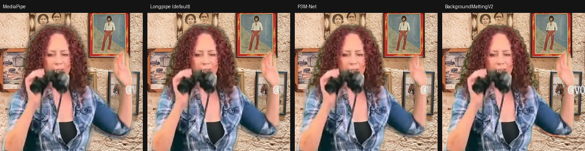

# BackgroundMattingV2 in Voxal: experimental engine and evaluation

Question: Voxal already photographs the empty room for its fixed-camera
reference. BackgroundMattingV2 is a matting network built to use exactly that
picture. Does it give a visibly better cut-out than the engines Voxal has, in
the real pipeline, fast enough for a call?

**Short answer.** Yes, on footage where the room has not changed since the
picture: it has **the lowest mask error of every engine measured** (RVM
included), the **cleanest edges** (least halo, least eaten edge, finest hair),
almost no holes, and its composite error is on par with RVM's and below the
default Longpipe's. It does that at **15 mattes a second with a 69 ms old
matte** on an M5 (19.5 ms per inference, nothing long on the main thread), from
a **10 MB** download, under the **MIT** licence (code and weights). Two things
were needed to get there: a re-export of its refiner (the published ONNX does
not run on WebGPU) and a small clean-up of floating islands (it sometimes calls
a patch of plain wall "person"). Its weakness is its premise: it needs the
picture of the empty room, so it is only as good as that picture is current.
The bench footage is the best case (a still photo of a room); a nudged camera
already costs it. It is wired in as an experimental engine that runs only while
the picture is usable and hands the camera back to MediaPipe otherwise. **Worth
trying on real webcams next**; not yet a default.



## Licence and weights

| Item | Licence | Notes |
|---|---|---|
| BackgroundMattingV2 code ([PeterL1n/BackgroundMattingV2](https://github.com/PeterL1n/BackgroundMattingV2), CVPR 2021) | MIT | `LICENSE`, © 2020 University of Washington |
| MobileNetV2 weights (`pytorch_mobilenetv2.pth`, release v1.0.0) | MIT | The README: "This work is licensed under the MIT License"; no separate weight licence |
| ONNX Runtime Web 1.30.0 | MIT | The same pinned build as P3M-Net |

It can ship. It is kept out of the repository and every build for now because
it is an experiment, not for its licence or its size (10 MB).

## What was built

* **`make bgm-assets`** (`scripts/bgm-assets.sh`): fetches the official code
  (pinned commit) and checkpoint (sha256-pinned, `torch.load(weights_only=True)`),
  makes a PyTorch venv in `.cache/bgm/`, converts, verifies, and stages the
  ONNX files with ONNX Runtime Web (through `scripts/p3m-fetch.sh
  --runtime-only`, same pins) in the gitignored `src/assets/bgm/`. Desktop builds
  delete it (`bgm-clean`); `build-web`, `cap-sync` and `vercel-build.sh` strip
  it.
* **`scripts/bgm-export.py`**, the conversion. The release's own ONNX files use
  the refiner's *sampling* mode: TopK picks the patches with the largest
  predicted error, NonZero / RoiAlign crop them, ScatterElements / If write them
  back. ONNX Runtime Web's WebGPU backend runs none of those, so each would run
  on the CPU inside the session (the P3M-Net lesson). The refiner's *full* mode
  is the same weights applied everywhere with ordinary convolutions. The export
  also re-implements `MattingRefine.forward` without its in-place `clamp_()` /
  `add_()` on slices, which PyTorch exports as ScatterND. Result: Conv, Resize,
  Pad, Concat, Clip, Add, plus integer shape arithmetic (the only 76 nodes ONNX
  Runtime keeps on the CPU, harmless). Verified at 640x360 and 1280x720 on a
  bench frame:

  | check | max |Δα| |
  |---|---|
  | export wrapper vs the official module (full mode) | 0 |
  | full mode vs sampling mode with every patch selected | 4e-5 |
  | ONNX fp32 (CPU and WebGPU) vs PyTorch | 0 / < 5e-5 |
  | ONNX w16 (half-float storage, fp32 compute) vs PyTorch | 0.02-0.09 (mean 3e-5) |

  One file per base scale (`bgm_mnv2_s25_*`, `bgm_mnv2_s50_*`): 10 MB (w16) or
  20 MB (fp32). The bench scores fp32 and w16 the same.
* **`src/bgm-engine.js`**, the adapter, shaped like P3M-Net's (asynchronous, one
  inference in flight, WebGPU only unless `bgm-ep=wasm`, Cache Storage, falls
  back to MediaPipe when it cannot start or dies). It takes the plate with
  `setPlate({w, h, rgba, gain})` and builds the network's second input from it,
  rebuilt only when the picture or the gain changes. It returns the alpha and
  the person's own colour (`fg`, used by the composite where the matte is
  partial, as RVM's is). It then clears **stray islands**: parts of the matte
  not connected to the rest, under 15% of the largest, that touch no edge of the
  picture (see below).
* **`video-effects.js`**: `bgm` is a fifth engine, with a matte engine's
  settings (no MediaPipe cut, no dilate, half feather, the 0.6 blend). What is
  new is that it is **plate-gated**, in `Processor.syncBgm()`:
  * a camera starts on MediaPipe; as soon as the empty room's picture is
    loaded, matches and is not being retaken, it swaps to BackgroundMattingV2,
    under the running camera (same track, no renegotiation);
  * the picture goes stale (camera moved, light changed), a new one is being
    taken, or *Fixed camera* is switched off: back to MediaPipe;
  * the picture's per-channel gain (the webcam re-metering since the capture,
    measured every 500 ms) is handed to the model with it;
  * the cruder per-pixel reference pass stands down while it runs (the model
    already compared the frame with the picture);
  * a matte covering more than 75% of the picture for a second is treated as a
    stale picture, not a person, and BackgroundMattingV2 is held off for 15 s.
    Without this, a stale picture can never be detected: everything that
    changed is "person", and the staleness check only looks at what the model
    calls room;
  * a BackgroundMattingV2 that cannot start is not retried on every update.
* **UI**: Settings → Advanced → Segmentation debug → *Segmentation engine* →
  **BackgroundMattingV2**, plus *input size*, *base scale*, *model file* and
  *edge dilate*. The diagnostic panel's engine list, info line (model, input,
  plate, gain, inference time, matte rate) and *Compare engines* view (while a
  picture of the room is loaded) include it. `?segengine=bgm` selects it for one
  visit.
* **`scripts/matting-bench.mjs`**: `bgm` and its variants (input size, base
  scale, fp32, a full-size plate, a plate with uncorrected gain, a nudged
  camera, no foreground colour, no island clean-up). The harness hands the
  engine the footage's empty room (`plate.png`) at the app's own 640-px plate
  size.
* **`tests/e2e/unit-bgm-engine.spec.js`** (14 tests, an ONNX Runtime stub):
  input sizing, configuration, engine choice, missing files, both pictures fed
  at the same size with the whole plate (not clipped) and its gain, no WebGPU,
  the island clean-up, and through the real Processor: MediaPipe until the room
  is photographed then BackgroundMattingV2 on that picture, back to MediaPipe on
  a stale picture, a retake or the reference switched off, the coverage guard
  and its hold-off, and an engine that cannot start not being retried.

## Quality: the matting bench (known alpha)

Footage, harness and scores are those of `docs/matting-evaluation.md` (a
green-screen clip composited over three room photos, 300 frames, 1280x720,
every engine through Voxal's real pipeline). Lower is better except IoU. Run on
an Apple M5, Chromium with WebGPU on Metal, 2026-11-05.

| engine | room | mask | maskMAE | band | IoU | dtSSD | comp | outer | mixed | inner | compDt | leak % | hole ‰ |
|---|---|---|---|---|---|---|---|---|---|---|---|---|---|
| MediaPipe | wall | 256x144 | 8.5 | 166 | 0.963 | 2.15 | 1.16 | 23.4 | 22.9 | 5.0 | 4.70 | 15.6 | 1.42 |
| Longpipe | wall | 256x144 | 14.7 | 174 | 0.969 | 1.84 | 0.62 | 4.9 | 15.5 | 4.9 | 4.01 | 3.4 | 0.20 |
| RVM | wall | 512x288 | 5.7 | 125 | 0.980 | 1.41 | 0.51 | 0.6 | 12.3 | 5.0 | 2.95 | -1.1 | 0.22 |
| P3M-Net | wall | 384x224 | **4.7** | 103 | 0.981 | 1.81 | 0.63 | 4.6 | 14.4 | 5.7 | 3.84 | 3.1 | 0.42 |
| **BGMv2** | wall | 640x360 | 5.0 | **91** | 0.979 | 1.91 | 0.59 | 1.0 | **12.2** | **3.7** | 3.36 | **0.2** | **0.04** |
| MediaPipe | living | 256x144 | 14.1 | 227 | 0.939 | 2.32 | 1.47 | 23.8 | 30.6 | 9.6 | 5.60 | 12.0 | 7.74 |
| Longpipe | living | 256x144 | 17.3 | 195 | 0.958 | 2.00 | 0.91 | 8.4 | 23.9 | 7.8 | 4.89 | 5.1 | 3.00 |
| RVM | living | 512x288 | 6.9 | 139 | 0.971 | **1.49** | 0.68 | **1.2** | 19.4 | 7.2 | **3.87** | **2.7** | 1.49 |
| P3M-Net | living | 384x224 | 8.6 | 153 | 0.962 | 3.30 | 0.91 | 8.0 | 21.3 | 8.1 | 4.88 | 5.4 | 4.46 |
| **BGMv2** | living | 640x360 | **5.3** | **115** | **0.978** | 1.78 | **0.66** | 2.7 | **19.3** | **4.0** | 4.30 | 6.0 | **0.66** |
| MediaPipe | kitchen | 256x144 | 18.2 | 239 | 0.927 | 2.68 | 1.51 | 22.9 | 26.8 | 10.1 | 5.48 | 8.9 | 9.12 |
| Longpipe | kitchen | 256x144 | 16.7 | 196 | 0.960 | 2.26 | 0.82 | 8.3 | 19.9 | 5.4 | 4.71 | 7.5 | 0.90 |
| RVM | kitchen | 512x288 | 6.9 | 142 | 0.975 | **1.48** | 0.60 | 1.5 | 15.9 | 5.7 | **3.47** | **1.2** | **0.30** |
| P3M-Net | kitchen | 384x224 | 16.9 | 196 | 0.925 | 4.58 | 1.42 | 7.7 | 20.8 | 11.7 | 4.85 | 4.7 | 16.31 |
| **BGMv2** | kitchen | 640x360 | **4.7** | **98** | **0.982** | 1.59 | **0.59** | 2.1 | **15.9** | **3.5** | 3.78 | 4.1 | 0.89 |

Reading it:

* **Edges are where it wins**: the edge band's error (`band`) is the lowest of
  every engine in every room, the eaten edge (`inner`) is the lowest, and hair
  (`mixed`) is level with RVM's or better. The halo (`outer`) is close to RVM's,
  a fraction of Longpipe's and P3M-Net's.
* **Holes and dropouts are gone** compared with MediaPipe and P3M-Net: a pixel
  that is the room in the picture and not the room now is the person, whatever
  it looks like.
* **RVM is still steadier** (dtSSD, compDt) and leaks less of the old room into
  the edge band. RVM is recurrent; BackgroundMattingV2 sees each frame on its
  own. RVM's weights are GPL and cannot ship; BackgroundMattingV2's are MIT.
* The **old room's leak** in the edge band (4-6% on the photographed rooms) is
  its weakest edge score, though still at or below Longpipe's.

### The island clean-up

Before it, BackgroundMattingV2 had the worst whole-mask error on the plain wall
(14.3): now and then it called a patch of flat wall "person", well away from
anybody, where frame and plate are identical. That was checked in Python on the
original network: the same patch appears whatever is done to the plate (exact,
re-encoded as JPEG, blurred, with noise added), so it is the model, not the
input. Those patches are islands: separate from the person, small, touching no
edge. Clearing islands under 15% of the largest that touch no edge (a hand
coming in from the side of the picture touches it and is kept; a second person
is large and is kept):

| room | maskMAE before | after | comp before | after |
|---|---|---|---|---|
| wall | 14.3 | 5.0 | 1.09 | 0.59 |
| living | 11.0 | 5.3 | 1.34 | 0.66 |
| kitchen | 8.8 | 4.7 | 0.93 | 0.59 |

The edge scores, holes and dropouts are unchanged: it removed nothing of the
person. It costs **0.8 ms** per matte on the main thread (640x360). It is a
rule, not a model: a real object that is not a person (a chair pushed into the
picture) and floats is cleared too, which is arguably right for a call.

### Sizes and settings

| variant (living / kitchen) | maskMAE | band | comp | leak % | infer ms |
|---|---|---|---|---|---|
| **640 input, base at 1/4 (default)**, with clean-up | **5.3 / 4.7** | 115 / 98 | **0.66 / 0.59** | 6.0 / 4.1 | 30 |
| 640, base at 1/2 | 21.0 / 16.4 | 104 / 90 | 2.47 / 1.52 | 4.2 / 3.1 | – |
| 960, base at 1/4 | 16.1 / 14.0 | 111 / 94 | 1.94 / 1.29 | 7.2 / 4.6 | – |
| 1280, base at 1/4 | 18.4 / 15.3 | 111 / 91 | 2.16 / 1.38 | 6.5 / 4.3 | – |
| 960, base at 1/2 | 14.9 / 10.7 | 109 / 91 | 1.78 / 1.10 | 6.3 / 3.5 | 62 |
| 1280, base at 1/2, with clean-up | **4.7 / 3.9** | 108 / 91 | **0.64 / 0.55** | 8.7 / 4.2 | 100 |
| fp32 weights (640) | 11.0 / 8.7 | 115 / 99 | 1.33 / 0.92 | 6.0 / 4.1 | – |
| full-size plate (640) | 11.0 / 8.8 | 115 / 99 | 1.34 / 0.92 | 6.0 / 4.1 | – |
| no foreground colour (640) | 11.0 / 8.8 | 115 / 99 | 1.30 / 0.89 | 8.0 / 5.4 | – |

Rows without "with clean-up" were measured before it existed and compare with
the 640 default's own pre-clean-up numbers (11.0 / 8.8 mask error); the clean-up
moves every setting the same way. In short: **the 640 default is the right
size for the time it costs**; 1280 at half scale is a little better and three
times slower. Storing the plate at only 640 wide costs nothing, the half-float
weights cost nothing, and the model's foreground colour lowers the leak.

### What a real room will do to it

The footage's rooms are still photographs, so the plate is perfect. Two
variants stand in for a real webcam (640 default, before the clean-up):

| variant | living maskMAE / leak | kitchen maskMAE / leak |
|---|---|---|
| exact plate | 11.0 / 6.0% | 8.8 / 4.1% |
| plate's colour off by +6% R, -7% B (uncorrected) | 9.4 / 4.0% | 8.1 / 3.9% |
| camera nudged 3x2 px at 1280 since the plate | 12.1 / 9.8% | 14.7 / 7.9% |

A colour drift does not hurt (and the app corrects most of it anyway, with the
gain). **A moved camera does**: a few pixels already raise the error by up to
two-thirds on a busy room. A laptop lid touched, a desk bumped, a phone held
in a hand: each is a reason to retake the picture, and on a phone the picture is
never valid for long (the app's own staleness check then hands the camera back
to MediaPipe). Not in the footage at all: the person's shadow and their light
on the wall (a real person changes the room behind them), webcam noise against
an averaged, noise-free plate, and the room changing over a call (a door, a
window's light).

## Performance

The Processor's own loop, camera fed at 30 fps, 1280x720, M5, WebGPU:

| engine | out fps | mask Hz | infer ms p50/p95 | runSegment ms p50/p95 | mask age ms p50/p95 | long tasks ms/s | start ms |
|---|---|---|---|---|---|---|---|
| MediaPipe | 29.8 | 24.0 | – | 6.68 / 9.54 | 9 / 34 | 0 | 112 |
| Longpipe | 29.5 | 15.4 | its model 5.3 | 7.38 / 11.60 | 1 / 28 | 21 | 1062 |
| P3M-Net | 29.7 | 14.6 | 49.8 / 56.0 | 2.23 / 3.73 | 95 / 146 | 8 | 771 |
| RVM | 29.6 | 14.6 | 33.6 / 45.1 | 2.66 / 4.56 | 80 / 105 | 8 | 609 |
| **BGMv2 640** | **29.6** | **15.2** | **19.5 / 25.6** | 2.31 / 5.88 | **69 / 98** | **0** | 464 |
| BGMv2 960, 1/2 | 29.9 | 14.1 | 51.0 / 56.6 | 2.70 / 4.30 | 96 / 144 | 0 | 521 |
| BGMv2 1280, 1/4 | 29.6 | 8.8 | 65.2 / 76.1 | 4.52 / 10.06 | 156 / 226 | 0 | 406 |
| BGMv2 1280, 1/2 | 29.7 | 7.8 | 91.9 / 100.0 | 3.73 / 6.66 | 178 / 241 | 8 | 444 |

(The Processor starts an inference only on its own ~66 ms tick, so 15 mattes a
second is the ceiling for any engine faster than that.) The fastest of the
matting models, and the freshest matte of the three. The mask age is
Longpipe's and MediaPipe's advantage: theirs is the current frame.

In ONNX Runtime Web directly (no pipeline), 640x360 is 34 ms per run on WebGPU
and 43 ms on WASM with 4 threads; WASM blocks the main thread, so it is never
used unless asked for by name.

## How to try it on your own camera

```sh
make bgm-assets         # ~1 GB PyTorch venv in .cache/bgm (once), 20 MB checkpoint, converts and stages
make run-web            # or make dev
```

Then Settings → Advanced → Segmentation debug → *Segmentation engine* →
**BackgroundMattingV2**, pick a background, and photograph the empty room from
the room's background popover (*Fixed camera*). Until that picture exists, the
diagnostic's info line says the camera is on MediaPipe. `?segdiag=compare` puts
it beside the others once the picture is taken.

## Remaining limitations

* **Measured on composited footage only.** No real webcam, no real room, no
  shadow, no noise; the perturbed-plate variants are the only proxy.
* **The picture must be current.** A moved camera degrades it within a few
  pixels; on a phone it will rarely be in charge.
* **Every number is from one machine** (Apple M5, Chromium). No Windows GPU,
  no Safari, no phone.
* **Not deployed**: there is no published converted model, so preview deploys
  do not carry it. Publishing one would be a `bgm-model-v1` prerelease asset
  with a fetch script, exactly like P3M-Net's.
* The island clean-up's 15% and its no-border rule are judgment, checked on
  this footage only.

## Possible improvements

* **Learn the plate instead of asking for it.** The fixed-camera reference
  already learns the room by itself from what holds still (`texLearnA`); feeding
  that learned picture would make the engine useful without a capture, and
  keep it current as the light changes.
* **Re-anchor on small camera moves**: the reference already estimates a
  translation for phones (`shift`); shifting the plate by it would cover the
  nudged-camera case.
* **Its leak**: dilate is 0 for it; a small one, or RVM's-style colour
  treatment of the edge band, are A/B switches away (`bgm-dilate`).
* A temporal blend tuned for it (it uses the shared 0.6).
