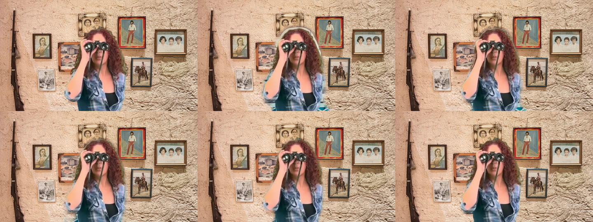

# Foreground matting evaluation: MediaPipe, Longpipe, RVM

Question: would a video-matting model — Robust Video Matting (RVM) or another
browser-compatible one — integrate the person into Voxal's virtual backgrounds
more naturally than the two engines already wired in (MediaPipe's selfie
segmenter and Longpipe), and what in the current compositing is wrong whichever
model is used? Priority: natural integration first, real-time performance second.

**Short answer.** RVM's matte is clearly the best of the three (half MediaPipe's
mask error, a third less temporal error) and runs in real time on WebGPU — but it
is **GPL-3.0, weights included**, so it cannot ship in Voxal without a separate
licence. More importantly, the biggest artefact in today's composite — the halo of
the old room round the hair and shoulders — was **not the model at all**: it was
the pipeline's edge dilate and its asymmetric temporal blend. Feeding the *ground
truth* alpha through the shipped MediaPipe settings left more of the old room in
the edge band (47%) than MediaPipe's own mask did (38%). Those settings are now
retuned by measurement; the composite error fell by ~25–40% for every engine,
including Longpipe (the default) and MediaPipe (the fallback).

## Licensing (verified 2026-10-31)

| Engine | Code | Weights | Fit for Voxal (MIT, shipped in App Store / Play builds) |
|---|---|---|---|
| MediaPipe selfie segmenter | Apache-2.0 | Apache-2.0 (model card) | Yes (shipped) |
| Longpipe | MIT | MIT | Yes (shipped, default engine) |
| RVM (PeterL1n/RobustVideoMatting) | **GPL-3.0** (re-licensed 2021-09-16) | Published in the same repository's v1.0.0 release with no separate licence: GPL-3.0 is the only grant | **No**, not without a separate licence from the rights holders |
| ONNX Runtime Web (runs RVM here) | MIT | — | Yes |

RVM's `LICENSE` is the GNU GPL v3 and its README says "Code is re-released under
GPL-3.0 license". Distributing Voxal with RVM's code or weights would subject the
distributed work to GPL-3.0 (corresponding-source offer for the whole combined
work, no further restrictions — which also collides with App Store terms). So the
prototype here never puts RVM in the repository or in a build:

* `make rvm-assets` downloads ONNX Runtime Web 1.30.0 and RVM's ONNX weights,
  pinned by sha256, into the gitignored `src/assets/rvm/`.
* `make build` / `build-signed` / `build-debug` delete that directory first
  (`rvm-clean`); `build-web` and `cap-sync` strip it from their outputs.
* `src/rvm-engine.js` is inert without it: choosing RVM falls back to MediaPipe
  and says why.

## What was built

* **Common engine interface.** `createSegmenter(raw, engine)` in
  `video-effects.js` now takes `mediapipe`, `longpipe` or `rvm` (localStorage
  `segmentation-engine`, `?segengine=`, the diagnostic panel's engine select,
  Settings → Advanced → Segmentation debug). Everything after the mask — dilate,
  feather, temporal blend, hair refinement, decontamination, scenes, light — is
  shared, so a difference in the picture is the model's or the pipeline's, and the
  bench separates the two.
* **RVM engine** (`src/rvm-engine.js`): ONNX Runtime Web, WebGPU with a WASM
  fallback, MobileNetV3 or ResNet50, fp32 or fp16, recurrent state carried across
  frames and reset on a new source. Asynchronous: the matte trails the picture by
  about one inference (measured below). Its `fgr` output (the person's colour
  with no room behind it) is used for decontamination in the edge band.
* **Footage with a known alpha** (`make matting-footage`,
  `scripts/matting-footage.mjs`): a public-domain VOA green-screen clip (curly
  red hair, a waving hand, sweeping arms) is keyed and composited in linear light
  over two CC0 room photos and a plain wall. 300 frames at 30 fps, 1280x720;
  ground-truth alpha and foreground written alongside. Every engine sees
  byte-identical frames.
* **Benchmark** (`make matting-bench`, `scripts/matting-bench.mjs` +
  `tests/bench/matting/harness.html`): the real Processor, its real shaders,
  stepped one frame at a time on Chromium with the **real GPU** (ANGLE/Metal,
  WebGPU), into the same target background with the same settings. Scores the raw
  mask, its temporal error, and the final composite against the true composite —
  split into the halo (truth 0), the partial pixels (hair), the eaten edge (truth
  1), its frame-to-frame error, and the share of the old room left in the edge
  band ("leak"). An **oracle** engine feeds the ground truth itself through the
  pipeline, to tell model error from pipeline error. A `--realtime` mode runs the
  Processor's own loop at 30 fps for timing.

## Main artefacts, and where they come from

| Artefact | Seen as | Source (measured) |
|---|---|---|
| **Halo of the old room** round hair, shoulders, arms | A light rim (window, wall) round the head over the new background | **Compositing**: the 3-texel dilate before feathering (≈15 px at 1280 wide). The ground truth fed through it leaked 47% of the old room in the edge band; MediaPipe's own mask 38%. |
| **Trailing ghost** behind a moving arm or head | Old room trailing the silhouette for a few frames | **Temporal handling**: the asymmetric blend (grow 0.85 / shrink 0.20) keeps dropped pixels for several inferences. |
| **Coarse, rounded silhouette** | Hair outline smoothed into a helmet, gaps between strands filled | **Segmentation resolution**: MediaPipe's and Longpipe's masks are 256x144, upsampled 5x at 1280x720; RVM's is 512x288 or the camera's size. |
| **Background colour in mixed pixels** | Hair and motion-blurred hands tinted by the old room | **Edge contamination**: a mixed camera pixel is part room; mixing it again over the new background keeps that share. Voxal's colour-line decontamination halves it; RVM's `fgr` removes most of the rest. |
| **Edge flicker** | Rim boiling frame to frame | **Model temporal instability**: MediaPipe's mask flickers ~2.6x more than RVM's where the truth does not change. |

## Results

### Models, through the pipeline as it shipped (before the retune)

Average over the three rooms, 300 frames each, real GPU (Apple M5, Chromium 156).
Lower is better except IoU. Mask scores are at the camera's size (the mask
upsampled as the GL pipeline does); composite scores are in 0-255.

**1280x720**

| Engine | mask | mask MAE ×1000 | band MAE ×1000 | IoU | dtSSD | flicker | composite MAE | halo (outer) | hair (mixed) | eaten (inner) | leak % |
|---|---|---|---|---|---|---|---|---|---|---|---|
| MediaPipe | 256x144 | 13.6 | 211 | 0.943 | 2.38 | 1.79 | 2.32 | 47.7 | 30.5 | 3.4 | 38.0 |
| Longpipe | 256x144 | 16.2 | 188 | 0.962 | 1.98 | 1.63 | 1.29 | 24.1 | 24.2 | 3.8 | 16.0 |
| RVM MobileNetV3, 512 px | 512x288 | **6.5** | 135 | 0.975 | 1.46 | **0.68** | 1.04 | 17.4 | 23.8 | 2.4 | 17.5 |
| RVM MobileNetV3, camera size | 1280x720 | **6.4** | **133** | 0.975 | 1.56 | 0.69 | **0.87** | **8.4** | **21.2** | 2.7 | **13.5** |
| RVM ResNet50, 512 px | 512x288 | 7.6 | 145 | **0.976** | **1.39** | 0.71 | 1.02 | 16.2 | 22.9 | 2.7 | 16.7 |

**640x360**: same ranking (MediaPipe 2.37 / Longpipe 1.41 / RVM 1.18 / RVM camera
size 1.12 / ResNet50 1.15 composite MAE; leak 38 / 15 / 17 / 16 / 16%).

* RVM's raw matte has **half** MediaPipe's error and **0.4x** Longpipe's, and a
  third less temporal error (dtSSD) than either.
* ResNet50 is **not** better than MobileNetV3 on this footage (mask error 7.6 vs
  6.5) and costs ~9x the inference time: not worth it.
* RVM at the camera's own size (its deep guided filter on) gives the finest
  composite: the halo halves again.
* Longpipe's mask error is the highest, yet its composite was far better than
  MediaPipe's: the difference was the pipeline's settings (no confidence cut, ~1
  texel of dilate instead of 3), not the model.

### Pipeline vs model: the oracle

The ground truth itself through the pipeline (living + kitchen, 640x360 / 1280x720):

| Fed in | Pipeline settings | composite MAE | leak % |
|---|---|---|---|
| truth at 256x144 | MediaPipe's (cut 0.78, dilate 3) | 2.78–3.11 | **47–49** |
| truth at 256x144 | matte engine's (no cut, dilate 1) | 1.53–1.79 | 21–26 |
| truth at 512x288 | matte engine's | 1.08–1.35 | 18–21 |
| RVM at 512x288 | matte engine's (as shipped) | 1.01–1.39 | 15–21 |

A perfect mask was *worse* than MediaPipe's under MediaPipe's settings, and RVM
was already at the ceiling of the matte settings. So the next gains had to come
from compositing, independent of model selection.

### Compositing fixes (A/B, same footage)

Each switch on its own, then combined (living + kitchen, 640x360). `compDt` is the
composite's frame-to-frame error against the truth's over the edge band — flicker
and trailing together, so a fix that trades a halo for flicker shows up there.

| Engine | Variant | composite MAE | halo | eaten | compDt | leak % |
|---|---|---|---|---|---|---|
| MediaPipe | as shipped (dilate 3, blend 0.85/0.20) | 2.74 / 2.36 | 54 / 44 | 3.8 / 3.6 | 5.92 / 5.38 | 38 / 33 |
| MediaPipe | dilate 0 | 1.60 / 1.68 | 8 / 7 | **19 / 19** | 4.92 / 4.76 | 0 / 1 |
| MediaPipe | dilate 2 + blend 0.6 | 1.82 / 1.74 | 32 / 28 | 7.0 / 7.7 | 5.80 / 5.52 | 20 / 14 |
| MediaPipe | **dilate 1.5 + blend 0.6** (new) | **1.61 / 1.62** | 22 / 21 | 9.0 / 10.0 | **5.17 / 5.10** | 12 / 8 |
| MediaPipe | dilate 1 + blend 0.6 | 1.46 / 1.56 | 15 / 14 | 11.4 / 12.6 | 4.78 / 4.83 | 6 / 4 |
| Longpipe | as shipped (dilate ≈1, blend 0.85/0.20) | 1.63 / 1.43 | 25 / 23 | 4.5 / 2.9 | 5.13 / 4.64 | 16 / 15 |
| Longpipe | dilate 0 + no blend | 1.11 / – | 6 / – | **14** / – | 4.15 / – | −1 / – |
| Longpipe | **dilate 0.5 + blend 0.6** (new) | **1.18 / 1.08** | 12 / 11 | 9.0 / 7.7 | **4.35 / 4.28** | 5 / 7 |
| RVM | as shipped then (dilate 1, blend 0.85/0.20) | 1.39 / 1.15 | 20 / 15 | 2.7 / 1.7 | 5.16 / 4.34 | 21 / 15 |
| RVM | linear-light mix alone | 1.34 / 1.14 | 18 / 15 | 3.0 / 1.8 | – | 19 / 15 |
| RVM | no decontamination | 1.46 / 1.23 | 24 / 17 | 2.4 / 1.6 | – | 26 / 23 |
| RVM | no hair refinement | 1.41 / 1.17 | 21 / 15 | 2.6 / 1.7 | – | 22 / 16 |
| RVM | identity edge ramp (no smoothstep) | 1.00 / 0.98 * | 5 / 5 | 11.6 / 13.1 | 3.77 / 3.72 | 4 / 4 |
| RVM | dilate 0 + no blend | 0.89 / 0.83 | 3.5 / 3.0 | 6.2 / 6.0 | 3.71 / 3.35 | 6 / 5 |
| RVM | **dilate 0 + no blend + linear + its `fgr`** (new) | **0.88 / 0.81** | 2.6 / 2.8 | 7.5 / 6.7 | **3.47 / 3.19** | **2.5 / 1.9** |

\* on top of dilate 0 + no blend.

What the table says:

* **Dilate** is the single largest lever. Too much is a halo; none eats the edge
  of every engine but RVM. The new values keep the eaten-edge error within about
  2x of before while halving (MediaPipe, Longpipe) or removing (RVM) the halo.
* **Temporal blend**: the asymmetric blend's slow shrink trails the old room
  behind motion. Symmetric 0.6 lowered the composite error *and* `compDt` for
  MediaPipe and Longpipe; for RVM (recurrent) any blend only adds lag.
* **Decontamination** (Voxal's colour-line projection) earns its keep on every
  engine (off: leak +5–7 points); a stronger setting (1.0) changed little.
* **Hair refinement** (joint bilateral) helps a little on every engine; kept.
* **Linear-light mixing** helps RVM slightly, and MediaPipe not at all: on for
  RVM only.
* **RVM's own foreground (`fgr`)** removes most of the remaining old-room colour
  in its band (leak 4.7 → 2.5%); on for RVM.
* **The edge smoothstep and the feather stay**: an identity ramp eats the edge;
  no feather trades halo for flicker.

### After the retune (full footage, as now shipped)

All three rooms, all 300 frames, same footage and settings as the first table;
only the pipeline's defaults changed (mask scores are unchanged by construction).

| Engine | camera | composite MAE | halo (outer) | hair (mixed) | eaten (inner) | leak % |
|---|---|---|---|---|---|---|
| MediaPipe | 640x360 | 2.37 → **1.51** | 45.2 → 21.6 | 29.0 → 25.6 | 2.9 → 7.9 | 38.0 → **11.4** |
| MediaPipe | 1280x720 | 2.32 → **1.38** | 47.7 → 23.1 | 30.5 → 26.7 | 3.4 → 8.4 | 38.0 → **11.8** |
| Longpipe (default) | 640x360 | 1.41 → **1.06** | 22.5 → 10.8 | 23.0 → 19.1 | 3.3 → 8.0 | 15.3 → **5.7** |
| Longpipe (default) | 1280x720 | 1.29 → **0.91** | 24.1 → 11.7 | 24.2 → 20.1 | 3.8 → 8.6 | 16.0 → **5.8** |
| RVM, 512 px | 640x360 | 1.18 → **0.81** | 16.0 → 2.4 | 22.4 → 14.8 | 2.0 → 6.6 | 17.1 → **1.3** |
| RVM, 512 px | 1280x720 | 1.04 → **0.62** | 17.4 → 2.5 | 23.8 → 15.4 | 2.4 → 7.2 | 17.5 → **1.0** |
| RVM, camera size | 1280x720 | 0.87 → **0.60** | 8.4 → 0.9 | 21.2 → 16.4 | 2.7 → 5.5 | 13.5 → **1.4** |

The trade is explicit: the halo and the old room's colour go, and the edge sits a
little tighter (eaten-edge error up ~5/255 on the inner ring), which is what the
smaller dilate means. The frame-to-frame error of the composite fell with it
(A/B table above).

Hair, living room, frame 60 — truth | MediaPipe before | after | Longpipe before |
after | RVM before | RVM at camera size, after:


Kitchen, frame 225 — top: truth | MediaPipe before | after; bottom: Longpipe
before | after | RVM at camera size, after:



(The olive rim in the hair is in the ground truth itself: see Limitations.)

## Performance

Apple M5 (10 cores, 32 GB), macOS 26, Chromium 156 headless with the real GPU
(ANGLE over Metal, WebGPU), cross-origin isolated (ORT WASM: 4 threads). Camera
fed at 30 fps; the Processor's own loop for 10 s after 3 s of warm-up. "mask age"
is how old the matte composited onto a frame is: the time since the frame that
matte was computed from (MediaPipe: the inference frame; RVM: its inference's
start). JS heap after the run.

| Engine | camera | start (ms) | out fps | masks/s | inference p50/p95 (ms) | main thread per inference p50/p95 (ms) | draw p50/p95 (ms) | mask age p50/p95 (ms) | long tasks (ms/s) | JS heap (MB) |
|---|---|---|---|---|---|---|---|---|---|---|
| MediaPipe | 640x360 | 121 | 30.0 | 24.0 | (in the main-thread figure) | 10.2 / 11.7 | 0.4 / 0.8 | 10 / 32 | 0 | 6 |
| MediaPipe | 1280x720 | 111 | 29.9 | 24.0 | – | 11.5 / 16.5 | 0.9 / 1.7 | 13 / 32 | 0 | 5 |
| Longpipe | 640x360 | 2155 | 30.1 | 15.2 | its model 6.8 | 8.6 / 11.8 | 0.3 / 0.6 | 1 / 26 † | 0 | 4 |
| Longpipe | 1280x720 | 2067 | 29.9 | 15.5 | its model 5.6 | 9.2 / 12.3 | 0.6 / 1.1 | 1 / 26 † | 0 | 5 |
| RVM MNv3 fp32, WebGPU, 512 px | 640x360 | 477 | 30.1 | 15.2 | 34.7 / 37.6 | 1.6 / 2.2 | 0.1 / 0.5 | 81 / 99 | 0 | 9 |
| RVM MNv3 fp32, WebGPU, 512 px | 1280x720 | 438 | 30.1 | 15.1 | 35.7 / 38.5 | 3.4 / 4.8 | 0.6 / 1.0 | 79 / 99 | 0 | 7 |
| RVM MNv3 fp16, WebGPU, 512 px | 640x360 | 477 | 30.0 | 15.3 | 35.6 / 38.8 | 1.9 / 2.8 | 0.1 / 0.4 | 69 / 99 | 0 | 12 |
| RVM MNv3 fp16, WebGPU, 512 px | 1280x720 | 461 | 30.0 | 15.7 | 37.1 / 42.4 | 3.2 / 5.1 | 0.5 / 1.0 | 68 / 101 | 0 | 8 |
| RVM MNv3 fp32, WASM, 512 px | 640x360 | 427 | **12.6** | 10.0 | 79.0 / 100.7 | 1.3 / 1.5 | 0.1 / 0.3 | 103 / 217 | **840** | 5 |
| RVM MNv3 fp32, WASM, 512 px | 1280x720 | 509 | **10.1** | 9.7 | 80.5 / 114.0 | 2.7 / 3.9 | 0.6 / 1.6 | 106 / 197 | **871** | 5 |
| RVM MNv3 fp32, WebGPU, camera size | 640x360 | 534 | 30.1 | 15.2 | 35.6 / 37.0 | 1.6 / 2.1 | 0.1 / 0.5 | 78 / 98 | 0 | 15 |
| RVM MNv3 fp32, WebGPU, camera size | 1280x720 | 474 | 30.0 | 14.5 | 45.0 / 49.7 | 4.2 / 6.3 | 0.1 / 1.1 | 95 / 130 | 0 | 9 |
| RVM ResNet50 fp32, WebGPU, 512 px | (quality runs) | – | – | – | ~300–340 | – | – | – | – | – |

† Longpipe's mask is read from its own output stream, which lags the camera by
its pipeline's latency; that lag is **not** visible to Voxal and not in this
figure.

* RVM on WebGPU holds 30 fps output with ~15 mattes/s (the Processor's
  inference interval), but each matte is ~70–95 ms old when composited — about
  2–3 frames. MediaPipe's is ~10–13 ms. That lag is the RVM prototype's main
  cost; on fast motion it shows as the matte trailing the picture. Running
  inference per frame or using its `fgr` as the picture would hide some of it;
  neither was done here.
* RVM on WASM (no WebGPU) is **not** real time: 10–13 fps output and ~0.85 s of
  long tasks per second. It needs WebGPU.
* fp16 is not faster than fp32 on this GPU through ORT-Web (not investigated further).
* The "inference" figure includes the CPU-side tensor building and read-back;
  the GPU time alone is lower. Not separated here.
* Start: RVM's session is ready in ~0.45 s with the model cached (the first
  WebGPU run compiles shaders: ~1.2 s once).

**Not measured: mobile.** No phone or tablet was available to this run. Nothing
above says anything about iOS Safari, Android Chrome or the Capacitor WebViews.
Known constraints rather than measurements: iOS Safari's WebGPU availability
varies by OS version, and without WebGPU RVM falls to WASM, which is not real
time even on an M5; RVM's weights are 15 MB (fp32) / 7.5 MB (fp16) on top of the
ONNX Runtime WASM (~27 MB) — a download the mobile apps would also have to fetch.

## Compatibility findings

* **ONNX Runtime Web 1.30's WebGPU backend cannot run RVM as published**: RVM's
  three source-pyramid `AvgPool2d(2, 2, ceil_mode=True)` hit "ceil_mode kernel
  execution ... is not yet implemented in the WebGPU AveragePool kernel", and only
  at the first `run()`, not at session creation. The adapter switches the flag to
  floor in the model's bytes in memory (`patchCeilMode()`); equivalent for inputs
  whose downsampled size is a multiple of 8, which `inputSize()` guarantees.
  WebGPU and WASM then give **identical** scores (verified). A runtime failure on
  WebGPU falls back to WASM once.
* Headless Chromium on macOS runs SwiftShader unless launched with
  `--enable-gpu --use-angle=metal --enable-unsafe-webgpu`; every figure above was
  taken with the real GPU (checked by the renderer string in each report).
* ORT's WASM threads need cross-origin isolation, which the deployed web app has
  (COOP/COEP in `vercel.json`); the bench serves the same headers.

## Recommended production approach

1. **Ship the compositing retune (done in this branch)**: MediaPipe dilate 1.5,
   Longpipe dilate 0.5, symmetric temporal blend 0.6. It improves every engine
   users have today, independently of model choice, and needs no new dependency.
2. **Do not ship RVM.** GPL-3.0 weights; and even licence aside its matte arrives
   2–3 frames late in real time, and it needs WebGPU. Keep it as an opt-in,
   never-shipped evaluation engine.
3. **If a better matte is wanted, look for a permissively licensed matting model
   with RVM's shape** (recurrent, alpha + foreground, ~4 MB), or ask the RVM rights
   holders for a commercial licence. The interface (`createSegmenter()` + the
   bench) is ready to score a candidate in minutes; the evidence says the gain to
   expect over the retuned Longpipe is in hair detail and temporal stability, and
   that it must come with the matting-engine settings (no cut, no dilate, no
   blend, its own foreground colour).
4. Longpipe stays the default. Its retune was measured with the bench holding
   each frame still for 150 ms (it cannot be stepped), which is kinder to it than
   a call; confirm the new edge on a device with the diagnostic panel.

## Tests

* `tests/e2e/unit-rvm-engine.spec.js` (10 tests, an ONNX-Runtime stub stands in for
  the GPL weights): input sizing, half floats, the `ceil_mode` patch flips exactly
  the set flags, the engine choice never selects RVM by default, a missing or
  failing RVM falls back to MediaPipe and says why, the recurrent state is fed
  back and reset, WebGPU gets the patched model and moves to WASM on a run
  failure, fp16 in and out, and the matte reaching the real Processor uncut at
  its own size with a matte's edge.
* Existing suites updated for the retune: `unit-longpipe-engine` (Longpipe's
  dilate now ~0.5 texel), `unit-seg-diagnostic` (the dilated-pane test pins a
  whole-texel stride; a fractional one greys the rim by design).
* Pre-existing failures unrelated to this branch (fail on `main` too, this
  machine): `unit-video-keyed` "withholds keying" ×2 (`slow-copy`),
  `unit-video-keyed-wiring` "keyed senders get a share of the cap".

## Limitations

* **One subject, one clip.** Curly red hair over CC0 rooms; no glasses, no dark
  hair over a dark room, no second person, no hands near the face for long.
* **The ground truth is a keyer's.** It carries an olive/magenta rim in the hair
  (green spill) that is identical in the input and the truth, so it costs every
  engine the same; the absolute numbers carry its error.
* **Linear-light compositing of the footage** is the physically right model of a
  camera, and it favours a linear-light mix by construction.
* **Longpipe could not be stepped** (it runs its own pipeline on a stream): each
  frame is held for 150 ms before its mask is read.
* **Quality runs have no lag by construction** (each engine's mask for frame N is
  composited onto frame N). Real-time lag is measured separately and is RVM's main
  weakness; the quality figures do not include it.
* **Scenes not scored**: the composite is scored against a still target image,
  because the animated scenes accumulate over time and have no exact truth. The
  scene path shares the matte, dilate, blend and decontamination measured here;
  its light wrap and shadow were not.
* **Mobile not measured** (see Performance).

## Reproducing

```sh
make matting-footage                     # ~2 min, downloads the PD clip + CC0 photos once
make rvm-assets ARGS=--with-resnet       # only for RVM (GPL-3.0; never committed or shipped)
make matting-bench                       # quality: all engines, rooms, 640x360 + 1280x720
make matting-bench ARGS='--realtime --engines mediapipe,longpipe,rvm,rvm-wasm'
make matting-bench ARGS='--engines rvm --rooms living --res 640x360 --variant-names "shipped,dilate0&noblend"'
node scripts/matting-bench.mjs --render bench-results/matting/<run>/results.json
```

Reports, PNG stills and `results.json` go to `bench-results/matting/` (gitignored).
