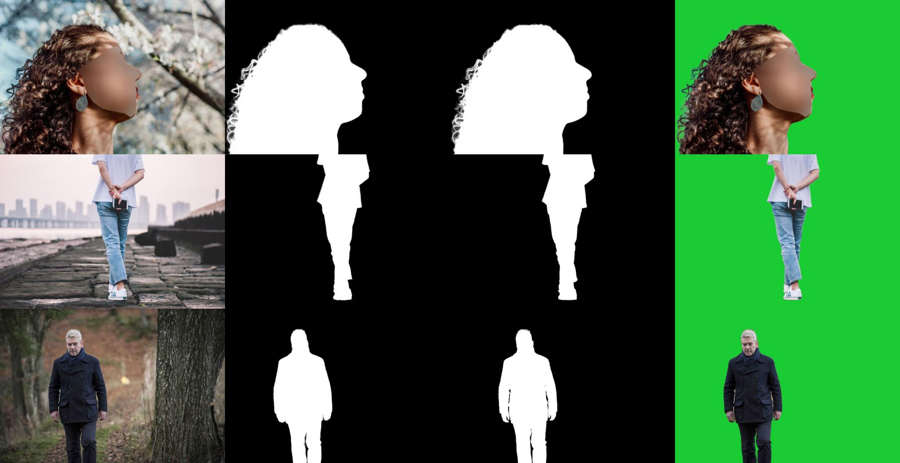
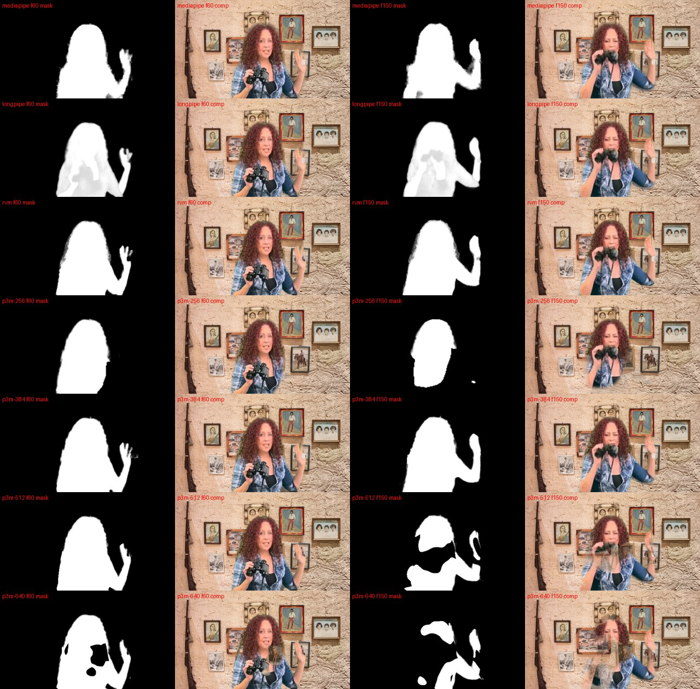
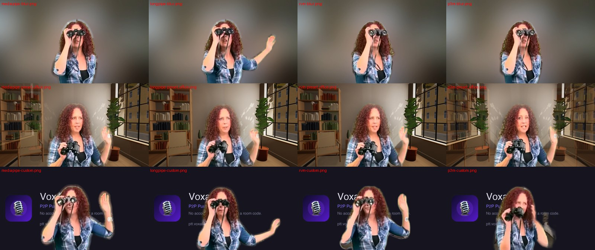

# P3M-Net in Voxal: experimental engine and evaluation

Question: does P3M-Net (Privacy-Preserving Portrait Matting) give a visibly
better matte than the engines Voxal already has — MediaPipe's selfie segmenter
and Longpipe (the default) — inside the real app, with the same compositing, and
without making the camera too slow?

**Short answer.** P3M-Net runs in Voxal on WebGPU, behind an experimental
switch, and its *edges* are as clean as RVM's (no light halo round the hair,
almost none of the old room left at the rim). But it is an **image** model
working on video: its trimap branch misjudges whole regions on some frames —
holes in the body, a raised arm dropped — so its average mask error is **worse
than MediaPipe's** on cluttered rooms, and its frame-to-frame error is the
worst of the matting engines. It is also very sensitive to its input size (384
px on the long side is the only size that held up), needs WebGPU (WASM is not
real time: 3.7 fps), is a 78 MB download, and its matte is ~95 ms old when
composited (MediaPipe: ~13 ms). On a plain wall it is the best engine measured.
Not recommended as a default; RVM's shape of model (recurrent) remains the
better direction, and the compositing retune already shipped matters more than
either.

## Licence and weights

| Item | Licence | Notes |
|---|---|---|
| P3M-Net code ([JizhiziLi/P3M](https://github.com/JizhiziLi/P3M), ACM MM 2021) | MIT | `LICENSE` in the repository |
| P3M-Net(ResNet-34) weights, "pretrained on P3M-10k" | MIT (the README: "This project is under MIT licence"; released from the same README) | 158 MB PyTorch checkpoint on Google Drive |
| P3M-10k training data | Release agreement "MIT License"; images collected "with free use license" | Not used here |
| [ViTAE-Transformer/P3M-Net](https://github.com/ViTAE-Transformer/P3M-Net) (IJCV 2023: ViTAE-S, Swin-T) | MIT | Not evaluated, see *Choice of variant* |
| ONNX Runtime Web 1.30.0 | MIT | Same pinned build as the RVM experiment |

Unlike RVM (GPL-3.0), P3M-Net can ship. It is kept out of the repository for
**size** — 78 MB (half-float weights) or 156 MB (float32), plus 29 MB of ONNX
Runtime — and of the desktop and mobile builds. **Vercel preview deploys carry
it only with `PREVIEW_ENGINES=1`** (a production deploy only with `P3M_ASSETS=1`), so the engines can be
compared live on a real device (the *Engines* tab of the diagnostic, see
`docs/video-effects.md`): `vercel-build.sh` downloads the converted model from the
[`p3m-model-v1`](https://github.com/ErwannRobin/Voxal/releases/tag/p3m-model-v1)
prerelease asset and ONNX Runtime from jsDelivr, both sha256-pinned
(`scripts/p3m-fetch.sh`). A prerelease, so the desktop updater's
`releases/latest` never sees it. A browser downloads the files only when
somebody picks P3M-Net (or opens the comparison); a failed download at build
time deploys without them
(P3M-Net then falls back to MediaPipe).

## Choice of variant and runtime

* **ResNet-34 (the original P3M-Net)** was chosen over the IJCV ViTAE-S / Swin-T
  variants: the CNN converts to standard ONNX ops, while ViTAE-S's reduction
  cells and attention are a heavier and riskier export for a browser, and would
  only be slower. Their better paper scores are on still portraits.
* **Runtime: ONNX Runtime Web on WebGPU**, the path already proven by the RVM
  experiment (same pinned ORT build, same adapter shape). TensorFlow.js would
  need a second conversion (ONNX → TF → TFJS) and has no WebGPU advantage here;
  MediaPipe's runtime only runs TFLite task models.
* **Do not assume Python inference transfers to the browser** — it did not, as
  published:
  * The network keeps argmax **indices** from five 3x3/stride-2 max-pools and
    rebuilds its local decoder with **MaxUnpool**. ORT-Web's WebGPU backend
    implements neither; such nodes are silently put on the CPU inside the
    session, copying full-size feature maps every frame.
  * A first rewrite still used `And`/`Or`/`Not` for tie-breaking: also CPU-only
    in ORT-Web (79 nodes fell back; ~100 ms per run).
  * `scripts/p3m-export.py` rewrites both **exactly** with MaxPool, Pad, strided
    Slice, Equal, Where and one DepthToSpace (DCR) per unpool. PyTorch's
    tie-break (first maximum in row-major order) is a Where chain visited
    last-to-first; its unpool collision rule (last write wins) is the candidate
    windows in increasing order. The fusion of the trimap and the local alpha is
    folded into the graph, and so is the ImageNet normalisation.
  * Verified against the original module on the repository's sample portraits
    at 512x288 and 672x384: **max difference 0** (PyTorch), **0.000** (ONNX
    fp32, ORT CPU); the half-float-weights file differs by ~1e-5 on average.
    Against the official HYBRID results shipped in the repository the
    single-pass matte differs by 0.1–0.3% (mean |Δα|).
  * After the rewrite only three constant Transposes stay on the CPU.
  * **Half-float compute is not usable**: alpha moved by 1–2.6% on average (up
    to 0.95 on a pixel) and saved ~7 ms. Half-float *storage* (fp32 compute) is
    the default file.



## What was built

* `make p3m-assets` (`scripts/p3m-assets.sh`): fetches the official code
  (pinned commit) and checkpoint (sha256-pinned; loaded with
  `torch.load(weights_only=True)`), makes a private PyTorch venv in
  `.cache/p3m/`, converts, verifies, and stages the ONNX files with ORT-Web
  (sha256-pinned) in the gitignored `src/assets/p3m/`. Desktop builds delete it
  (`p3m-clean`), `build-web` and `cap-sync` strip it.
* `make p3m-fetch` (`scripts/p3m-fetch.sh`): downloads the file that conversion
  produced (published as a prerelease asset) and the three ONNX Runtime files
  the WebGPU path loads, sha256-pinned. Preview deploys run it
  (`vercel-build.sh`, never fatal; production with `P3M_ASSETS=1`); `/assets/p3m/` is cached a day
  (`vercel.json`), and the engine keeps the model in Cache Storage anyway.
* `src/p3m-engine.js`: the engine, shaped like MediaPipe's ImageSegmenter so the
  Processor treats it like the others (same interface as `rvm-engine.js`).
  Asynchronous inference (one in flight, the newest matte handed over),
  **WebGPU only** — no WebGPU, or a kernel that fails at the first run, and the
  camera stays on MediaPipe (WASM only when forced with `p3m-ep=wasm`: it runs
  on the main thread and took the camera to 3.7 fps), the model kept
  in **Cache Storage** (`voxal-p3m-v1`) so a second start does not download it
  again, the model's bytes dropped after the first run, the session released on
  close, and a fall back to MediaPipe when it cannot start **or dies mid-call**
  (five failed runs in a row — a lost GPU device — instead of freezing on the
  last matte).
* `video-effects.js`: `p3m` is a fourth engine for `createSegmenter()`. Everything
  after the mask is the shared pipeline: same feather, temporal blend, hair
  refinement, decontamination, scenes, light, keyed sending. P3M-Net's settings
  are a matte engine's: no MediaPipe confidence cut, **no dilate** (P3M edge
  already reaches the outside; dilate 0.5/1 raised the leak from 8.6% to
  13.5/18.6%), the symmetric 0.6 temporal blend (it is not recurrent; no blend
  raised the composite's frame-to-frame error), sRGB mixing (linear light made
  no difference). Measured with the bench's A/B switches on `living`/`kitchen`.
* **UI**: Settings → Advanced → Segmentation debug → *Segmentation engine* →
  **P3M-Net**, in the main window's settings and the desktop preferences window,
  plus *P3M-Net input size*, *model file* and *edge dilate*. The diagnostic
  panel's engine select switches it under a running camera, and its info line
  prints P3M's model, size, inference time, matte rate and load timings.
  `?segengine=p3m` selects it for one visit. Switching never renegotiates: the
  canvas track is kept and the old engine feeds the picture until the new one is
  up; a size or model change rebuilds only P3M's session.
* `scripts/matting-bench.mjs`: engines `p3m`, `p3m-<size>`, `p3m-fp32`,
  `p3m-fp16`, `p3m-wasm`.
* `scripts/matting-live.mjs`: the **real app page** with the browser's camera
  (Chromium's fake device fed a Y4M clip, so every engine sees the same
  picture), `getUserMedia` → `VideoEffects.wrap()` exactly as a call does, per
  engine and background; start time (cold and warm cache), output fps, matte
  rate, main-thread time, CPU and memory of every browser process, and a still.
* `tests/e2e/unit-p3m-engine.spec.js` (14 tests, an ORT stub stands in for the
  weights): input sizing, configuration, the engine never chosen by default,
  `?segengine=p3m`, missing files, failure to start, a WebGPU kernel failing
  (no silent WASM), no `navigator.gpu` (refused unless forced), the matte uncut / undilated through the real Processor, a
  MediaPipe → P3M-Net → MediaPipe switch keeping the same live track and
  releasing the session, a size change rebuilding the session under the camera,
  and a P3M-Net dying mid-call handing the camera back to MediaPipe.

## Quality: the matting bench (known alpha)

Footage, harness and scores are those of `docs/matting-evaluation.md`: a
public-domain green-screen clip (curly red hair, waving hand, binoculars raised
to the face) keyed over three rooms (`wall`, `living`, `kitchen`), 300 frames,
every engine through the real Processor on byte-identical frames into the same
background, the **current** shipped compositing. Apple M5, Chromium 156, real
GPU. Average over the three rooms; lower is better except IoU. Mask error x1000
at the camera's size; composite scores in 0-255; `dtSSD` = the mask's temporal
error, `compDt` = the composite's frame-to-frame error at the edge, `leak` = the
old room's share left in the edge band.

**1280x720 camera**

| Engine | mask | mask MAE | band MAE | IoU | dtSSD | flicker | comp MAE | halo (outer) | hair (mixed) | eaten (inner) | compDt | leak % |
|---|---|---|---|---|---|---|---|---|---|---|---|---|
| MediaPipe | 256x144 | 13.6 | 211 | 0.943 | 2.38 | 1.79 | 1.38 | 23.1 | 26.7 | 8.4 | 5.30 | 11.8 |
| Longpipe (default) | 256x144 | 16.2 | 188 | 0.962 | 1.97 | 1.62 | 0.91 | 11.7 | 20.1 | 8.6 | 4.56 | 5.8 |
| RVM (GPL, reference) | 512x288 | **6.5** | **135** | **0.975** | **1.46** | **0.68** | **0.62** | **2.5** | **15.4** | 7.2 | **3.43** | **1.0** |
| P3M-Net 256 | 256x160 | 33.7 | 237 | 0.850 | 7.20 | 10.38 | 2.63 | 8.1 | 21.1 | 22.2 | 6.13 | −2.3 |
| **P3M-Net 384** (default size) | 384x224 | 10.1 | 150 | 0.956 | 3.23 | 1.99 | 0.99 | 6.7 | 18.8 | 8.6 | 4.55 | 4.3 |
| P3M-Net 512 | 512x288 | 8.8 | 144 | 0.962 | 3.18 | 2.33 | 0.87 | 5.1 | 18.6 | 7.3 | 4.41 | 4.5 |
| P3M-Net 640 | 640x352 | 21.2 | 147 | 0.905 | 6.19 | 8.64 | 1.62 | 3.3 | 18.7 | 8.3 | 4.78 | 2.9 |

**640x360 camera**: same picture — MediaPipe 1.51 / Longpipe 1.06 / RVM 0.81 /
P3M-Net 256 2.36 / 384 **1.12** / 512 1.18 / 640 2.27 composite MAE; mask MAE
13.4 / 16.2 / 6.6 / 28.3 / **10.0** / 11.7 / 28.9.

**Per room (mask MAE, 1280x720)** — where the average comes from:

| Engine | wall (plain) | living (pictures on a wall) | kitchen |
|---|---|---|---|
| MediaPipe | 8.5 | 14.1 | 18.2 |
| Longpipe | 14.7 | 17.3 | 16.7 |
| RVM | 5.7 | 6.9 | 6.9 |
| P3M-Net 384 | **4.7** | 8.6 | 16.9 |
| P3M-Net 512 | 4.3 | 10.4 | 11.7 |
| P3M-Net 640 | **4.0** | 23.5 | 36.1 |

What the numbers and the stills say:

* **Edges: P3M-Net is good.** Its halo (old room outside the silhouette) is
  6.7 at 384 against Longpipe's 11.7 and MediaPipe's 23.1; its leak 4.3%
  against 5.8% and 11.8%. In the hair, at the camera's size, it looks like RVM:
  no light rim. On the plain wall it has the lowest mask error of every engine,
  RVM included.
* **Regions: P3M-Net is unreliable.** Its global branch (the trimap) decides
  what is background, and on cluttered rooms it sometimes decides wrongly for a
  whole region: the arm raised beside the head vanishes, the body behind the
  binoculars gets holes, a picture frame on the wall becomes "person". These are
  the frames that make its average mask error worse than MediaPipe's in the
  kitchen and its flicker the worst of the matting engines.
* **Input size is not a quality knob, it is a lottery.** 256 loses the arm on
  most frames; 640 punches holes; 512 is better than 384 in the kitchen and
  worse in the living room. 384 (the official test's "half the photo" scale for
  this framing) is the only size that held up in every room, and is the default.
* **Temporal stability**: dtSSD 3.2 at 384, against RVM 1.5, Longpipe 2.0 and
  MediaPipe 2.4. An image model has no memory of the previous frame; the 0.6
  blend softens it, a larger blend would trail.
* **No foreground colour**: unlike RVM, P3M-Net returns only alpha, so the edge
  is decontaminated by Voxal's own colour-line projection, as for MediaPipe.

Living room, frames 60 and 150 (mask, then composite): MediaPipe, Longpipe,
RVM, P3M-Net at 256, 384, 512, 640.



## Live, in the real app

`scripts/matting-live.mjs`, the real `index.html`, the browser's camera fed the
`living` clip at 1280x720/30 fps, each engine with plain blur, the animated
office scene and a custom image. 10 s per run after 3 s of warm-up; Apple M5,
headless Chromium with the real GPU. CPU and RSS are every Chromium process
together (browser, GPU, renderer), idle work included; RSS is noisy run to run.

| Engine | background | start ms | out fps | mattes/s | inference ms p50/p95 | main thread % | long tasks ms/s | CPU % | RSS MB |
|---|---|---|---|---|---|---|---|---|---|
| MediaPipe | blur | 336 | 29.9 | (~24) | – | 18 | 0 | 47 | 823 |
| MediaPipe | office scene | 339 | 28.4 | | – | 19 | 10 | 50 | 913 |
| MediaPipe | custom image | 152 | 30.2 | | – | 18 | 0 | 43 | 614 |
| Longpipe | blur | 1694 | 30.1 | 16.5 | – | 14 | 0 | 66 | 757 |
| Longpipe | office scene | 348 | 30.2 | 16.3 | – | 14 | 0 | 67 | 647 |
| Longpipe | custom image | 259 | 30.1 | 15.2 | – | 10 | 0 | 64 | 713 |
| RVM | blur | 627 | 30.0 | 15.1 | 32/35 | 23 | 0 | 58 | 680 |
| RVM | office scene | 307 | 29.7 | 15.0 | 34/37 | 24 | 0 | 53 | 751 |
| RVM | custom image | 170 | 30.0 | 15.6 | 32/35 | 23 | 0 | 52 | 836 |
| P3M-Net 384, first start (cache empty) | blur | 907 | 29.8 | 12.5 | 50/56 | 20 | 11 | 55 | 1259 |
| P3M-Net 384 | office scene | 441 | 29.0 | 12.0 | 52/64 | 22 | 0 | 60 | 626 |
| P3M-Net 384 | custom image | 376 | 30.1 | 14.0 | 50/54 | 22 | 0 | 60 | 1081 |
| P3M-Net 384, warm (Cache Storage) | blur | 499 | 29.6 | 14.2 | 48/62 | 19 | 6 | 59 | 989 |
| P3M-Net 384, warm | office scene | 461 | 29.8 | 13.1 | 51/57 | 22 | 8 | 56 | 645 |
| P3M-Net 384, warm | custom image | 412 | 29.9 | 14.4 | 50/54 | 22 | 7 | 57 | 1067 |



* **The camera stays responsive**: 30 fps out with every background, the main
  thread no busier than with RVM (~20%), negligible long tasks. P3M-Net's work
  is on the GPU; the main thread pays ~3 ms per inference for the frame's
  read-back and tensor.
* **The matte is late**: ~50 ms of inference, started on the Processor's ~66 ms
  tick, so each matte is ~95 ms old (p95 ~150 ms) when composited — about three
  frames. MediaPipe's is ~13 ms. On fast motion the cut-out trails the person
  (visible in the stills above as the old room beside a moving hand).
* **Memory**: the session holds the float32 weights (156 MB once the half-float
  storage is widened at load); browser RSS peaked ~1.0–1.3 GB with P3M-Net
  against ~0.6–0.9 GB for the others. Each camera start builds a new session
  (as RVM does).
* **Start**: 0.4–0.9 s from `getUserMedia` to the first processed frame, served
  from localhost. Over a network the first start also waits for the 78 MB
  download: the camera's first frame waits for it (a swap under a running camera
  does not: the old engine keeps going).

### Real-time sweep (the Processor's own loop, bench footage, 1280x720)

| Engine | inference ms p50/p95 | mattes/s | matte age ms p50/p95 | out fps | long tasks ms/s |
|---|---|---|---|---|---|
| MediaPipe | (main thread, 11 ms) | 24.0 | 15/32 | 29.6 | 11 |
| Longpipe | its model 6.4 | 15.3 | 1/27 † | 30.0 | 0 |
| RVM 512 | 32/34 | 15.1 | 79/97 | 30.0 | 0 |
| P3M-Net 256 | 30/32 | 15.1 | 78/97 | 30.0 | 0 |
| P3M-Net 320 | 38/41 | 15.4 | 74/97 | 30.0 | 0 |
| **P3M-Net 384** | 48/54 | 14.0 | 94/150 | 29.7 | 0 |
| P3M-Net 512 | 78/85 | 7.9 | 159/227 | 29.7 | 0 |
| P3M-Net 640 | 113/121 | 7.2 | 191/258 | 29.9 | 0 |
| P3M-Net 384, fp32 file | 49/55 | 13.7 | 93/147 | 29.9 | 0 |
| P3M-Net 384, fp16 compute | 42/46 | 15.0 | 83/118 | 29.8 | 0 |
| P3M-Net 384, **WASM** (no WebGPU) | 260/272 | 3.6 | 269/299 | **3.7** | **968** |

† Longpipe's mask comes from its own output stream; its pipeline's lag is not
visible here.

* The GPU time of one 384x224 inference is 46 ms (WebGPU profiling): Conv 28 ms,
  the exact pool/unpool rewrite ~14 ms, the 64→1 full-resolution output conv
  alone 4.3 ms.
* 512 px misses the Processor's tick and halves the matte rate.
* **WASM is not an option**: ORT's WASM backend runs on the main thread, and the
  whole camera drops to 3.7 fps.

## Mobile and Safari

**Not measured on a device.** No phone was available, and Safari could not be
driven: WebDriver needs *Allow remote automation* in Safari's Developer
settings (Safari 26.6.2 is on the test Mac). What is known:

* **WebGPU is required** (see WASM above). Safari 26 enables WebGPU by default
  on macOS Tahoe, iOS 26 and iPadOS 26 ([WebKit bug
  299237](https://bugs.webkit.org/show_bug.cgi?id=299237): `navigator.gpu`
  needs those versions). Earlier iOS has no WebGPU: the engine then refuses and
  the camera stays on MediaPipe.
* ONNX Runtime Web's WebGPU backend on Safari is **not verified**: there are
  public reports of WebGPU device loss and a 26.4 regression with other
  libraries ([WebKit bug 315186](https://bugs.webkit.org/show_bug.cgi?id=315186),
  [imgui #9103](https://upd.dev/ocornut/imgui/issues/9103)). The engine's
  five-failures rule hands such a camera back to MediaPipe.
* The Capacitor apps never get the files (`cap-sync` strips them), and WebGPU in
  a `WKWebView` is a separate question ([Apple forum
  thread](https://developer.apple.com/forums/thread/770862)).
* Cost on a phone, by arithmetic only: ~10 GMAC per 384x224 inference; an M5's
  GPU does it in 46 ms through ORT-Web, a phone GPU is several times slower, so
  expect 100–200 ms (5–8 mattes/s, a matte 2–4 frames late) at 384, and 256 —
  the size a phone could afford — is the size whose matte falls apart. Plus a
  78 MB download and ~160 MB of GPU memory for the weights, against iOS's tab
  memory limits.

**Verdict for mobile: not viable as is.**

## How to try it on your own camera

```sh
make p3m-fetch           # download the published model + ONNX Runtime (107 MB) into src/assets/p3m
# or: make p3m-assets    # convert the official checkpoint yourself (~1 GB venv + 158 MB checkpoint in .cache/p3m)
make run-web             # or make dev (desktop); the files are served from src/
```

On a Vercel preview deploy with `PREVIEW_ENGINES=1` nothing else is needed: the files are there. Settings → Advanced →
Segmentation debug → *Segmentation engine* → **P3M-Net**,
then turn the camera on with a background. Switch between MediaPipe, Longpipe
and P3M-Net there (or in the diagnostic panel: *Segmentation diagnostic panel*
on, or `?segdiag=1`) while the camera runs: the picture changes in place, same
background, same controls. The diagnostic's info line shows P3M's inference
time, matte rate and load timings. Things to look at that the footage does not
contain: glasses (frames and lenses over a busy background), dark hair against a
dark room, a hand crossing the face, a second person, the light changing.

On a phone or in Safari: serve the app over HTTPS on the LAN (the camera needs a
secure context), keep COOP/COEP for ORT's threads, and check the diagnostic's
`on webgpu` — `on wasm` means the result is not representative.

Reproduce the measurements:

```sh
make matting-footage
make matting-bench ARGS='--engines mediapipe,longpipe,p3m-384,p3m-512'
make matting-bench ARGS='--realtime --engines mediapipe,p3m-256,p3m-384,p3m-512,p3m-wasm'
ffmpeg -framerate 30 -i bench-results/matting/footage/living/%04d.jpg -pix_fmt yuv420p /tmp/living.y4m
node scripts/matting-live.mjs --clip /tmp/living.y4m --engines mediapipe,longpipe,p3m
```

## Remaining limitations

* One synthetic subject: no glasses, no dark-on-dark, no lighting change, no
  second person. The live in-app run uses the same footage through the fake
  camera, so it shows the app's behaviour, not a real webcam's picture.
* Quality runs have no lag by construction; P3M-Net's ~95 ms matte age is
  measured separately and will show on fast motion.
* No device measurements (phones, Safari, Firefox).
* RSS figures are whole-browser and noisy.
* A camera start with P3M-Net selected waits for the model (download on the
  first start).

## Possible improvements

1. *(Done in this branch: P3M-Net refuses to run on WASM unless forced, and
   the camera stays on MediaPipe.)*
2. **Temporal smoothing of the trimap, not only the alpha**: most bad frames are
   a region flipping class for one or two frames. Feeding the previous fused
   alpha back as a prior (or a median over the last three trimaps) would attack
   the dominant error, but changes the model's contract; measure with the bench.
3. **Hybrid inference** as in the official test: global branch at a low size,
   local branch at a higher one. The global branch is where the failures are;
   running it at 384 and the local at 512–640 could keep 384's robustness with
   finer hair, at ~2x the cost.
4. **Cheaper unpooling**: the exact rewrite costs ~30% of the GPU time. A
   custom WebGPU kernel (or ORT gaining MaxUnpool) would bring 384 to ~35 ms.
5. **Start on MediaPipe, hand over to P3M-Net when it is up** — so the first
   camera start never waits for a download.
6. **Do not invest further in P3M-Net for Voxal**: the evidence points to a
   permissively licensed *recurrent* video matting model with RVM's shape (state
   carried between frames, alpha + foreground, ~4 MB) as the real upgrade. The
   bench and the engine interface score a candidate in minutes.
